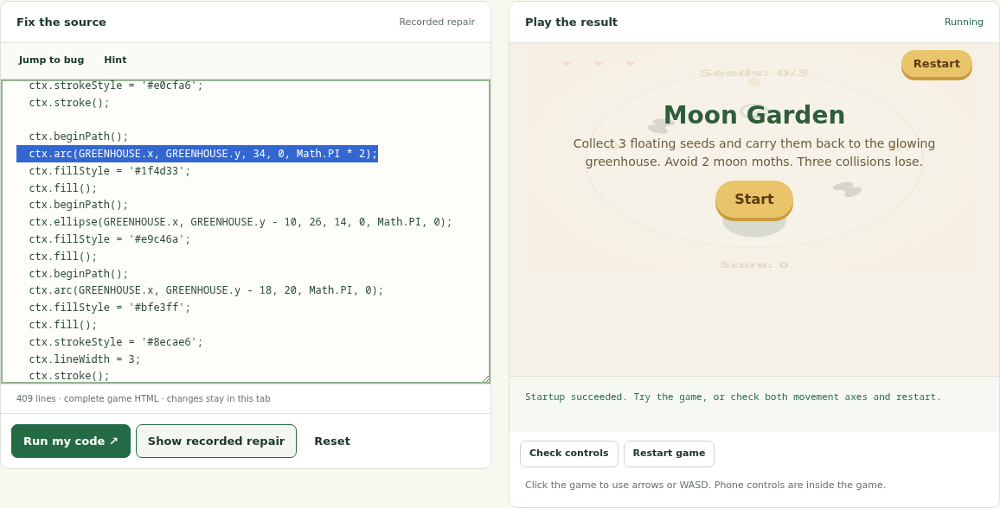

# Flint Repair Clinic by alphaBell

Three real Flint coding failures, with editable source, browser errors, exact recorded repairs and playable results.

**[Try Flint Repair Clinic](https://huggingface.co/spaces/alphabell/Flint-Repair-Clinic)**

- **Moon Garden:** a circle loses its start angle.
- **Bee Bop:** one parenthesis stops the entire game.
- **Cloud Courier:** Canvas calls return undefined, so chaining `.fill()` crashes rendering.

Run the broken candidate, try your own change, or reveal the recorded repair. Compare the complete diff and download each case as JSON. No inference call, API key or login is needed.

The cases are real adjacent attempts from the public [Flint Arcade Trajectories](https://huggingface.co/datasets/alphabell/Flint-Arcade-Trajectories) development dataset. Stock [Recursive Flint](https://huggingface.co/RecursiveSI/flint), in Q8_0 form, generated both the failed candidates and recorded repairs. AlphaBell authored the game briefs, feedback and harness. Case records retain the original exported HTML, SHA-256 hashes, source dataset revision and historical checks. These examples used historical full-document repairs; they are separate from the current Arcade's focused source-edit repair loop.

The live quick check exercises startup, synthetic keyboard movement along both axes and restart. It is a debugging aid, not a complete gameplay review or an independent acceptance gate. The historical selected candidates also have release review records in the source dataset. Three curated examples cannot estimate a model's overall success rate.

Game previews use an opaque-origin sandbox iframe with network access denied by a restrictive content-security policy. Editing runs code locally in that preview. The static app does not send edits to alphaBell or execute server-side code. Recorded evidence remains separate from live checks on your edited source.

## Files

`cases.json` contains the three complete before/after documents, recorded feedback, diffs and provenance. `index.html`, `style.css` and `app.js` are the complete application. Serve this directory with any static HTTP server.

The pinned source revision and per-candidate hashes are in `cases.json`. The case download includes both candidates and the original error, so it can serve as input to a local repair harness. Retain related attempts in the same data split if using these cases for training or evaluation.

For browser regression checks, install `requirements-dev.txt`, run `python -m playwright install chromium`, then `python verify.py`. The check script starts its own local static server and closes its browser on completion. It uses an installed `chromium` when available, or Playwright's managed Chromium. Set `CHROMIUM_PATH` to choose another executable.

[Technical write-up](https://huggingface.co/blog/alphabell/flint-repair-clinic) · [Source on GitHub](https://github.com/alphabell-research/flint-repair-clinic) · [Build a new game in Flint Arcade](https://huggingface.co/spaces/alphabell/Flint-Arcade) · [alphaBell](https://huggingface.co/alphabell)
